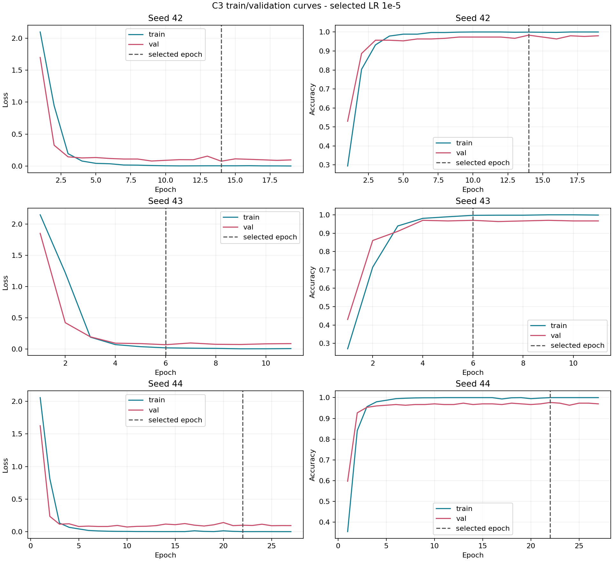

# C3 production training report

Nine completed Kaggle runs: three learning rates x three seeds.
Recorded validation scores were independently reproduced on CPU for all nine checkpoints.
Test images and test metrics were not used.

## Per-run selected checkpoints

| LR | Seed | Best epoch | Validation macro-F1 | Epochs run |
|---:|---:|---:|---:|---:|
| 1e-3 | 42 | 1 | 0.018181818181818181 | 6 |
| 1e-3 | 43 | 1 | 0.018181818181818181 | 6 |
| 1e-3 | 44 | 1 | 0.018181818181818181 | 6 |
| 1e-4 | 42 | 13 | 0.97664998300623806 | 18 |
| 1e-4 | 43 | 2 | 0.96318712690266572 | 7 |
| 1e-4 | 44 | 12 | 0.98999907381680097 | 17 |
| 1e-5 | 42 | 14 | 0.98332962860053708 | 19 |
| 1e-5 | 43 | 6 | 0.97009742849716329 | 11 |
| 1e-5 | 44 | 22 | 0.97666018338427352 | 27 |

## Learning-rate selection

| LR | Seed 42 | Seed 43 | Seed 44 | Mean | Sample std | Selected |
|---:|---:|---:|---:|---:|---:|:---:|
| 1e-3 | 0.018181818181818181 | 0.018181818181818181 | 0.018181818181818181 | 0.018181818181818181 | 0 | no |
| 1e-4 | 0.97664998300623806 | 0.96318712690266572 | 0.98999907381680097 | 0.97661206124190159 | 0.013406013683297484 | no |
| 1e-5 | 0.98332962860053708 | 0.97009742849716329 | 0.97666018338427352 | 0.97669574682732463 | 0.0066161717377039506 | yes |

Selected LR: `1e-5`. Validation macro-F1: `0.97669574682732463 +/- 0.0066161717377039506` (sample std, ddof=1).
Exact mean ties select the smaller LR. All three selected-LR checkpoints are retained.

## Overfitting check

Dashed lines mark the checkpoint selected by validation macro-F1, not by validation loss.
Training metrics use augmented images during optimization; validation uses deterministic transforms, so their gap is not a pure generalization estimate.

| Seed | Best epoch | Final epoch | Train loss at best | Final train loss | Val loss at best | Final val loss | Best val F1 | Final val F1 |
|---:|---:|---:|---:|---:|---:|---:|---:|---:|
| 42 | 14 | 19 | 0.003686 | 0.000609 | 0.075360 | 0.095613 | 0.983330 | 0.979992 |
| 43 | 6 | 11 | 0.019121 | 0.007192 | 0.069397 | 0.086673 | 0.970097 | 0.966557 |
| 44 | 22 | 27 | 0.000767 | 0.000337 | 0.098783 | 0.093048 | 0.976660 | 0.970048 |

Each selected-LR run stopped after five epochs without a higher validation macro-F1. The retained checkpoint precedes this plateau; the table and curves show the later train/validation behavior.

For seeds 42 and 43, training loss continues to decrease after the selected epoch while validation loss increases and validation macro-F1 declines. This is consistent with late-stage overfitting. Seed 44 also ends with lower validation macro-F1 despite lower training loss, but its validation loss does not increase between the selected and final epochs; its validation curve fluctuates rather than showing a monotonic decline. Retaining the validation-selected checkpoint avoids using the worse final epoch in all three runs.

The selected LR 1e-5 exceeds 1e-4 by only about 0.000084 mean validation macro-F1, much less than either across-seed standard deviation. The protocol selects 1e-5 by its higher mean; these three seeds do not establish a statistically reliable advantage over 1e-4.

## Production protocol and provenance

ImageNet V2 ResNet50; all parameters trainable; BatchNorm running statistics frozen and checked after each epoch;
AdamW; batch 32; microbatch 4; augmentation enabled; maximum 30 epochs; patience 5.
Training: Kaggle Tesla T4, Python 3.13.15, PyTorch 2.11.0+cu128, torchvision 0.26.0+cu128.
Source commit: 37f1e666390bde90743cc5ec765f286359c04d90, clean working tree.
Original source and split hashes match the repository. Delivered run files are preserved byte-for-byte.
runtime.json files were checked in the source ZIPs and intentionally omitted from runs/. Completion evidence and runtime hashes are in manifest.json.
Evaluation environment and evaluator hash are recorded in manifest.json. No separate test evaluation was performed.
