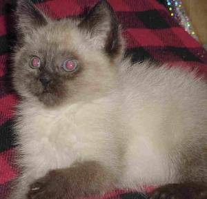
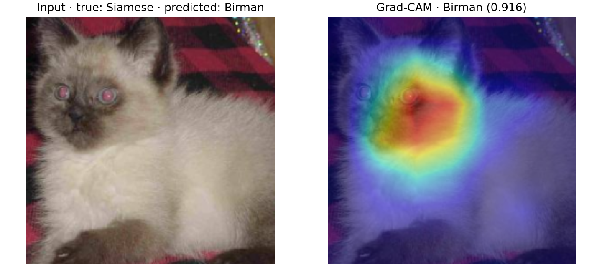
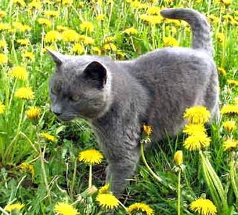
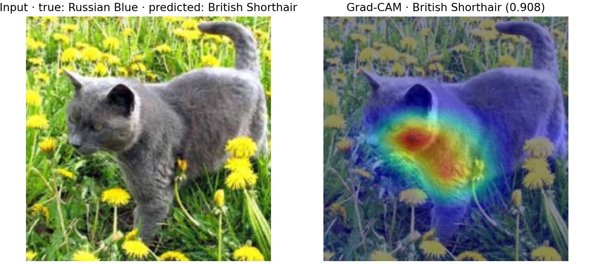
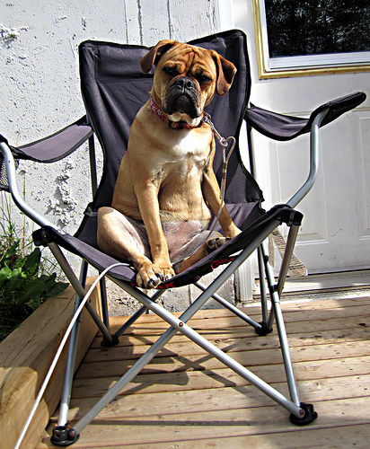
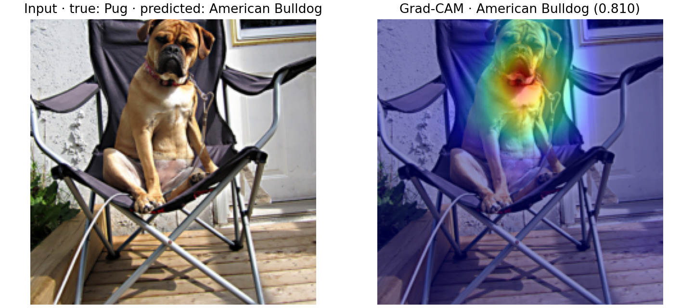

# Failure analysis: similar-breed confusion

## Scope and evidence

This is a post-evaluation diagnostic review of three **C0, augmentation-on**
failures on the frozen [`splits/v2/test.csv`](../splits/v2/test.csv) split.
C0 is the ImageNet V2 ResNet50 baseline with only its 10-class head trained;
its selected learning rate is `1e-3`. Images were selected from rows with
`correct=0` in the saved [C0 test predictions](tables/C0_augment_on_test_predictions.csv).
No model, preprocessing, checkpoint, or hyperparameter is selected or changed
using this analysis.

The updated repository did not contain `reports/errors/`. The three original
JPEGs have therefore been exported there from the local Oxford-IIIT Pet data,
without re-encoding, alongside Grad-CAM overlays generated with the matching
retained checkpoints. [`errors/cases.csv`](errors/cases.csv) records each
prediction, seed, checkpoint, image/overlay path, and SHA-256 hashes of the
source image and checkpoint. Labels below are dataset annotations, not an
independent visual verification of pedigree.

| Case | True class → predicted class | C0 seed | Predicted-class softmax |
| --- | --- | ---: | ---: |
| `Siamese_257` | Siamese → Birman | 44 | 0.916469 |
| `Russian_Blue_264` | Russian Blue → British Shorthair | 44 | 0.907743 |
| `pug_74` | Pug → American Bulldog | 42 | 0.809928 |

These are illustrative high-confidence failures, chosen to cover two cat
confusions and one dog confusion with supporting visualizations. They are not
a random sample. In C0's 900 saved predictions (300 images × three seeds),
there are **44 incorrect predictions on 16 distinct images**. Siamese → Birman
accounts for 12 errors; Russian Blue → British Shorthair for 9, and the reverse
direction for 7; Pug → American Bulldog for 3. These counts reuse images across
seeds and must not be interpreted as independent samples.

## How to read the Grad-CAM panels

Each figure shows the **actual 224×224 model input on the left** and an overlay
for the **incorrect predicted class on the right**. The separate JPEG shows
the full source photograph. Evaluation resizes the shorter side to 232, takes
a 224×224 center crop, and applies ImageNet normalization; the overlay is
aligned to that crop, not to the full photograph.

[`scripts/generate_gradcam.py`](../scripts/generate_gradcam.py) loads the model
in evaluation mode and differentiates the predicted-class **logit** with
respect to the output of `model.layer4`. Spatially averaged gradients weight
the feature channels; their sum is passed through ReLU, bilinearly enlarged
to 224×224, and min–max normalized per image. Red/yellow shows higher relative
positive support and blue lower support in that visualization. The overlay
uses the `jet` colormap with alpha 0.45. It is evidence about spatial support
for a score, not a segmentation mask or proof of the reason for a decision.

## Case 1 — Siamese mistaken for Birman

**Image:** `Siamese_257`; true label **2**, predicted label **3**; C0 seed
**44**, softmax **0.916469**.





**Visible evidence.** The photograph is low resolution and soft, with a
cream-colored, fluffy-looking coat and a dark face and ears. Both eyes have
pronounced pink/red flash reflections. The crop retains the head and much of
the torso but provides little clear evidence of standing proportions, coat
length, or paw markings. The strongest Grad-CAM region is the central face,
around the eyes, nose, and muzzle; the body is much less emphasized.

**Probable cause: shared color-point facial features with weak distinguishing
detail.** The emphasized dark facial mask against pale fur is compatible with
both Siamese and Birman appearances. Soft detail and reflected eye light make
fine facial/eye cues unreliable, while the fluffy silhouette can resemble
the predicted class. The map supports a hypothesis that shared facial cues
outweighed distinguishing evidence; it cannot establish which texture or eye
feature the model used. It also does not establish that the annotation is
wrong.

**Persistence.** All three C0 seeds predict Birman. All nine retained C1–C3
checkpoints also predict Birman in their saved test tables. Thus, this example
is not resolved by the evaluated deeper fine-tuning conditions, although that
observation does not identify its cause.

## Case 2 — Russian Blue mistaken for British Shorthair

**Image:** `Russian_Blue_264`; true label **1**, predicted label **0**; C0 seed
**44**, softmax **0.907743**.





**Visible evidence.** A solid gray cat is photographed outdoors among bright
yellow flowers. Its head faces left rather than toward the camera. The
rounded near ear, cheek, and dense-looking gray coat are visible, while fine
eye detail and a symmetric frontal head outline are difficult to assess.
Vegetation overlaps parts of the lower body. The strongest map response lies
below the near ear, across the cheek/neck and shoulder; the rear torso and
tail receive much less support. Most flowers are also relatively cool.

**Probable cause: similar gray-coat/head cues under an oblique pose.** Russian
Blue and British Shorthair can share a solid blue-gray appearance. This pose
and lighting make finer differences in head geometry, ear proportions, and
coat texture harder to distinguish. Local cheek/neck support is consistent
with reliance on those ambiguous cues rather than the complete silhouette.
The busy setting reduces visible detail, but the map does **not** justify a
claim that flowers caused the error or that the model primarily used the
background.

**Persistence.** All three C0 seeds make this same error. C1 seed 43, C2 seed
44, and C3 seed 43 classify the image correctly; the other six C1–C3
checkpoints still predict British Shorthair. The confusion is recurring but
sensitive to the trained checkpoint.

## Case 3 — Pug mistaken for American Bulldog

**Image:** `pug_74`; true label **5**, predicted label **4**; C0 seed **42**,
softmax **0.809928**.





**Visible evidence.** A tan dog with a dark, short muzzle and white chest sits
upright in a folding chair. The frontal pose, folded ears, wrinkled brow, and
broad chest are clear, but the chair and seated posture complicate judging
standing proportions. A curled tail is not clearly visible. Grad-CAM is
strongest around the lower muzzle, throat, and upper chest, with broader
support over the head. The chair, deck, and lower limbs are relatively cool.

**Probable cause: shared short-muzzle cues and an atypical body presentation.**
The broad short muzzle and chest can resemble the predicted bulldog class.
The seated photograph provides weak evidence of size and normal body shape,
and the strongest support falls on features shared with other short-muzzled
dogs. This supports a local appearance-confusion hypothesis. It does not
prove that the chair itself drove the prediction. The photograph also looks
atypical for the annotated Pug class; a pedigree, mixed-breed, or annotation
explanation remains unverified and must not be asserted from appearance alone.

**Persistence.** All three C0 seeds predict American Bulldog. For each of C1,
C2, and C3, seed 43 predicts Pug correctly, while seeds 42 and 44 still predict
American Bulldog. Greater fine-tuning depth does not consistently resolve
this example across seeds.

## Limitations

- **Diagnostic explanations are hypotheses.** Shared features, pose, glare,
  and missing detail are plausible contributors, not experimentally isolated
  causes. No occlusion, counterfactual, or true-class-versus-predicted-class
  attribution comparison was performed. Such checks would be separate
  diagnostic work and must not be used to tune on this test set.
- **Grad-CAM is coarse and class-specific.** ResNet50 `layer4` produces a
  7×7 spatial map for these inputs. Enlarging it smooths over small details;
  apparent support near an eye or muzzle cannot identify a precise anatomical
  feature. ReLU suppresses negative contributions, and the predicted-class
  map does not explain why that score exceeded the true-class score. Per-image
  normalization prevents comparing heat intensity across cases. Cool regions
  are not proof that those pixels had no influence.
- **Confidence is not correctness.** The listed values are maximum softmax
  probabilities, not calibrated reliability estimates. These three confident
  errors alone neither quantify calibration nor establish a safe rejection
  threshold.
- **Selection and sample size limit generalization.** Three deliberately
  selected C0 examples cannot describe all failures. The test set has only
  30 images per class, uses ten breeds and one custom split, and is not the
  official Oxford-IIIT Pet benchmark split. Repeated predictions on the same
  image are correlated; three seeds do not provide three independent datasets.
- **Photographs and annotations have limits.** Center cropping can remove
  useful context, and whole-image training uses no head boxes or segmentation
  masks. Breed labels are accepted from the frozen manifest; image appearance
  does not independently verify them. No image was relabeled or removed.
- **Cross-condition comparisons are descriptive.** The persistence notes use
  the existing [C1](tables/C1_augment_on_test_predictions.csv),
  [C2](tables/C2_augment_on_test_predictions.csv), and
  [C3](tables/C3_augment_on_test_predictions.csv) predictions, not Grad-CAMs
  for those models. Historical training environments and head initialization
  hashes differ across some conditions, as documented in the
  [ablation report](ablation.md#ограничения-сопоставимости). These observations
  cannot isolate fine-tuning depth as the cause of a changed decision.
- **Available evaluation is partial.** The committed test tables cover the
  four augmentation-on conditions. The [ablation report](ablation.md) supplies
  validation results for augmentation off; no matching augmentation-off test
  prediction tables are present. This report makes no test-level claim about
  the effect of augmentation.

## Reproduce the overlays

After installing the project dependencies, downloading the official images,
and fetching the Git LFS checkpoints, run from the repository root:

```powershell
python scripts/generate_gradcam.py --checkpoint deliverables/c0/runs/lr_1e-3/seed_44/best.pt --config configs/c0.yaml --image-id Siamese_257 --output reports/errors/gradcam_siamese_257.png --device cpu
python scripts/generate_gradcam.py --checkpoint deliverables/c0/runs/lr_1e-3/seed_44/best.pt --config configs/c0.yaml --image-id Russian_Blue_264 --output reports/errors/gradcam_russian_blue_264.png --device cpu
python scripts/generate_gradcam.py --checkpoint deliverables/c0/runs/lr_1e-3/seed_42/best.pt --config configs/c0.yaml --image-id pug_74 --output reports/errors/gradcam_pug_74.png --device cpu
```

The images in `errors/` are byte-for-byte copies of the corresponding
`data/oxford-iiit-pet/images/<image_id>.jpg` files. The saved prediction values
can be checked against `errors/cases.csv`; the generator prints the true
class, predicted class, and confidence for the specified checkpoint. This
diagnostic pass uses frozen checkpoints and does not rerun training or replace
the final evaluation tables.
