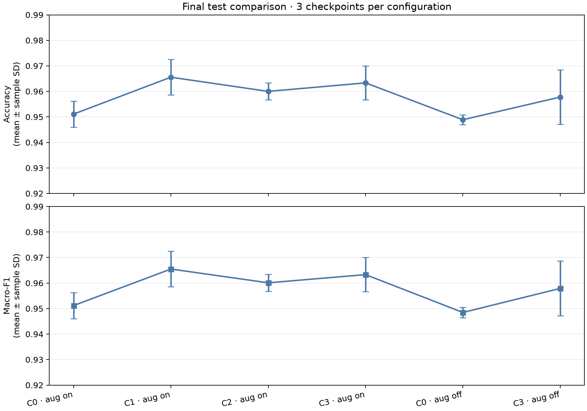
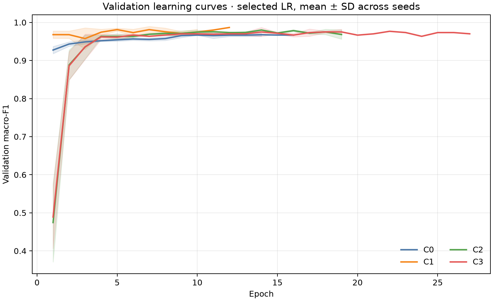
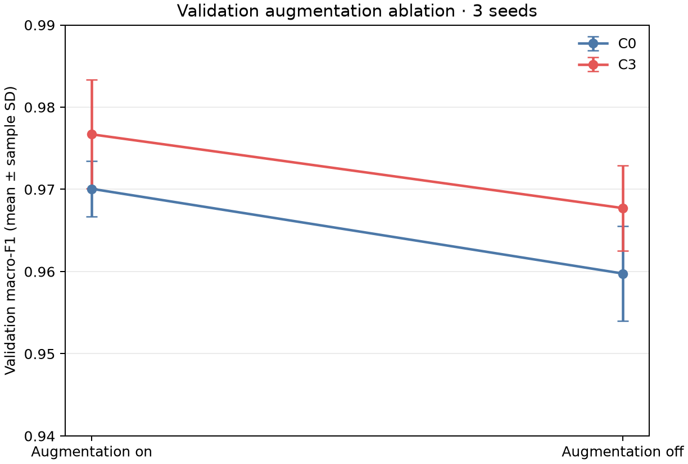
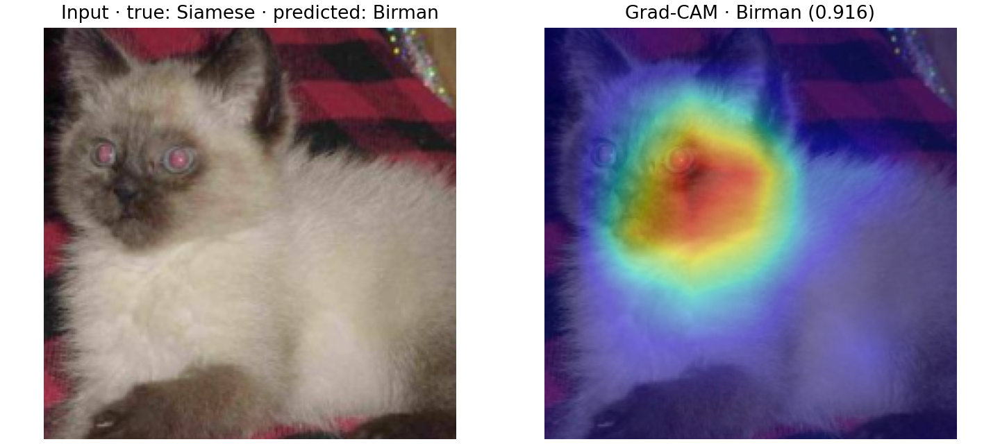
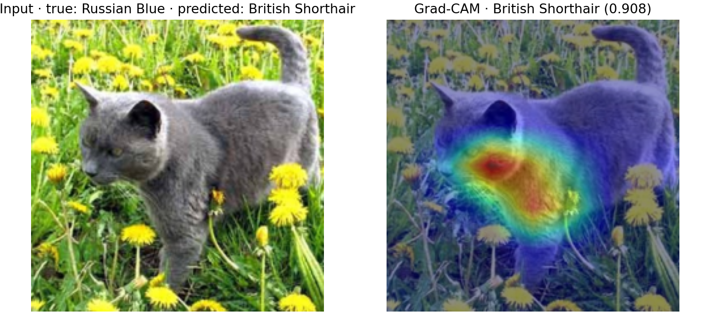
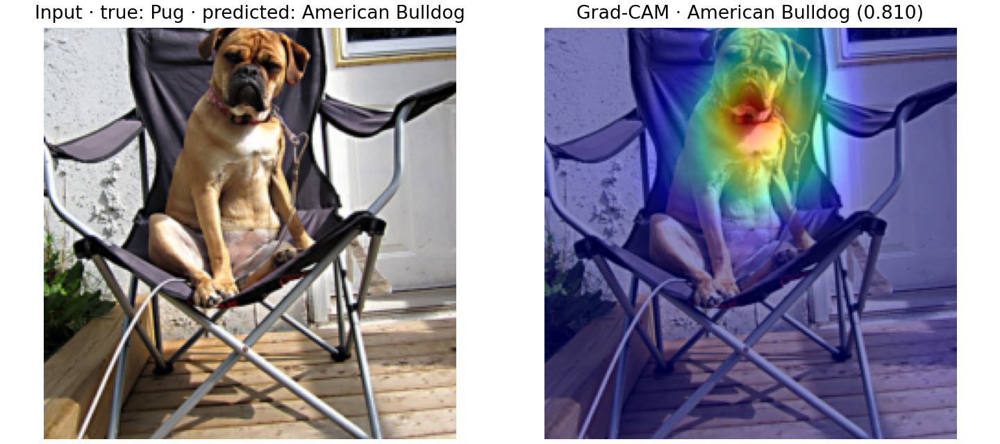

# Final Experimental Results

**Status: final and frozen.** This report consolidates the completed test
evaluation, validation ablation, final latency-only benchmark, and
post-evaluation failure review. The quality metrics and dated latency
measurements below are immutable; future replications must be reported
separately.

**Project repository:** [AnnaTikhonova-prog/Computer_Vision-project](https://github.com/AnnaTikhonova-prog/Computer_Vision-project)

## Evaluation protocol

The experiments use ImageNet V2 pretrained ResNet50 on the project's frozen,
stratified `splits/v2` split: 1,399 training, 300 validation, and 300 test
images from ten Oxford-IIIT Pet breeds. This is a project split, not the
official benchmark split. Each row aggregates the three retained checkpoints
trained with seeds 42, 43, and 44. Model and learning-rate selection used
validation macro-F1; the test split did not take part in selection. Values are
mean ± sample standard deviation (`ddof=1`) across the three checkpoints.

On 2 November 2026, inference latency alone was benchmarked again because the
original measurements did not record the CPU model. No dataset was loaded and
accuracy or F1 was not recalculated for that benchmark.

## Final test comparison

| Configuration | Trainable modules | Selected LR | Test accuracy | Test macro-F1 |
| --- | --- | ---: | ---: | ---: |
| C0 · augmentation on | Classifier head | `1e-3` | 0.9511 ± 0.0051 | 0.9512 ± 0.0051 |
| C1 · augmentation on | `layer4` + classifier head | `1e-4` | **0.9656 ± 0.0069** | **0.9655 ± 0.0070** |
| C2 · augmentation on | `layer3`–`layer4` + classifier head | `1e-5` | 0.9600 ± 0.0033 | 0.9601 ± 0.0033 |
| C3 · augmentation on | All parameters | `1e-5` | 0.9633 ± 0.0067 | 0.9633 ± 0.0067 |
| C0 · augmentation off | Classifier head | `1e-3` | 0.9489 ± 0.0019 | 0.9485 ± 0.0020 |
| C3 · augmentation off | All parameters | `1e-5` | 0.9578 ± 0.0107 | 0.9579 ± 0.0107 |

C1 has the highest mean test accuracy and macro-F1 among the six tested
configurations. Against the head-only C0 baseline with augmentation, its mean
accuracy is higher by 1.44 percentage points and macro-F1 by 1.43 points.
Unfreezing more layers did not produce a monotonic increase: C2 and C3 both
score below C1. The augmentation-off test results are slightly lower than the
corresponding augmentation-on results for C0 and C3. This is a descriptive
comparison, not evidence of a statistically significant or isolated causal
effect; training provenance varies across these historical runs.

The three-checkpoint spread reflects variation among checkpoints on the same
300 test images. It is not a confidence interval over independent test sets.
**No settings are changed based on test results.**

## Validation curves and augmentation ablation

The selected-LR training curves show validation macro-F1 by epoch, averaged
across the three retained seeds. Shading shows ± one sample standard deviation
among the seeds available at that epoch.

The pre-specified augmentation ablation was run on C0 and C3. Validation
macro-F1 was 0.9701 ± 0.0034 with augmentation and 0.9598 ± 0.0058 without it
for C0; for C3 it was 0.9767 ± 0.0066 and 0.9677 ± 0.0052, respectively. The
corresponding test metrics are included in the comparison table above. These
on/off differences are descriptive; the documented historical differences in
training environment and initialization limit causal interpretation.

## Runtime and computational measurements

The canonical inference latency values below come from the CPU-only benchmark
on 2 November 2026. Each checkpoint was measured with 10 timed forward passes
after 3 warm-ups, using `torch.inference_mode()`, `time.perf_counter()`, and a
synthetic zero-valued float32 input of shape N×3×224×224. Values are the mean ±
sample SD of the three checkpoint means. Batch-32 values are total batch time;
per-image latency is shown in parentheses.

| Configuration | Batch 1, ms | Batch 32, ms per batch (ms/image) |
| --- | ---: | ---: |
| C0 · augmentation on | 79.40 ± 4.88 | 2031.67 ± 14.41 (63.49 ± 0.45) |
| C1 · augmentation on | 118.97 ± 57.01 | 2421.08 ± 359.52 (75.66 ± 11.23) |
| C2 · augmentation on | 86.72 ± 6.62 | 2162.50 ± 94.36 (67.58 ± 2.95) |
| C3 · augmentation on | 87.58 ± 11.59 | 2045.25 ± 7.39 (63.91 ± 0.23) |
| C0 · augmentation off | 96.01 ± 36.43 | 2403.26 ± 494.30 (75.10 ± 15.45) |
| C3 · augmentation off | 90.74 ± 18.80 | 2100.44 ± 48.81 (65.64 ± 1.53) |

**Display erratum, 5 November 2026:** C1's batch-32 per-image SD is `11.23 ms`
(`359.5163754496131 / 32`), correcting the earlier `11.24` display. The recorded
timings, checkpoint-level CSV, and all quality metrics are unchanged; no new
benchmark or model evaluation was used for this arithmetic correction.

The benchmark ran on a 13th Gen Intel Core i5-1335U (12 logical CPUs), Windows
11 build 26300, Python 3.14.6, PyTorch 2.14.1+cpu, and torchvision 0.29.1+cpu,
with 10 PyTorch intra-op and 10 inter-op threads. See the full
[checkpoint-level latency CSV](tables/latency_rerun_2026-11-02.csv),
[runtime provenance record](tables/latency_rerun_2026-11-02_runtime.json), and
[benchmark script](../scripts/benchmark_inference_latency.py). Training
wall-clock duration was not recorded in retained metadata, so no training-time
claim is made here.

## Failure analysis

Three representative, high-confidence errors from C0 with augmentation on
were reviewed with Grad-CAM. The explanations are plausible visual hypotheses,
not causal findings; these cases were selected descriptively and were not
used to adjust the models.

1. **Siamese → Birman (`Siamese_257`, seed 44; confidence 0.916).** The
   low-detail close crop emphasizes a color-point face shared by both breeds;
   eye glare and little visible body-shape context make distinguishing cues
   difficult. Grad-CAM support is strongest around the face.
2. **Russian Blue → British Shorthair (`Russian_Blue_264`, seed 44; confidence
   0.908).** The oblique pose and outdoor lighting show a gray coat but obscure
   fine facial and coat-texture distinctions. The heatmap emphasizes the
   cheek, neck, and shoulder rather than the full silhouette.
3. **Pug → American Bulldog (`pug_74`, seed 42; confidence 0.810).** A seated,
   front-facing pose in a chair obscures body proportions, while the short
   muzzle and broad chest are shared visual cues. The map emphasizes the
   muzzle, throat, and upper chest.

The detailed [failure analysis](failure_analysis.md) contains source images,
checkpoint provenance, cross-seed observations, and limitations. Grad-CAM is a
coarse, class-specific visualization; it does not prove which feature caused
a prediction.

## Per-class and per-configuration artifacts

Per-class F1 values are the mean and sample SD across the three checkpoints.
Confusion matrices pool their predictions on the fixed test split. Each
prediction file contains 900 rows (300 images for each of the three seeds).

| Configuration | Per-class F1 | Confusion matrix | Predictions | Summary |
| --- | --- | --- | --- | --- |
| C0 · augmentation on | [CSV](tables/C0_augment_on_test_per_class_f1.csv) | [PNG](figures/C0_augment_on_test_confusion_matrix.png) | [CSV](tables/C0_augment_on_test_predictions.csv) | [CSV](tables/C0_augment_on_test_summary.csv) |
| C1 · augmentation on | [CSV](tables/C1_augment_on_test_per_class_f1.csv) | [PNG](figures/C1_augment_on_test_confusion_matrix.png) | [CSV](tables/C1_augment_on_test_predictions.csv) | [CSV](tables/C1_augment_on_test_summary.csv) |
| C2 · augmentation on | [CSV](tables/C2_augment_on_test_per_class_f1.csv) | [PNG](figures/C2_augment_on_test_confusion_matrix.png) | [CSV](tables/C2_augment_on_test_predictions.csv) | [CSV](tables/C2_augment_on_test_summary.csv) |
| C3 · augmentation on | [CSV](tables/C3_augment_on_test_per_class_f1.csv) | [PNG](figures/C3_augment_on_test_confusion_matrix.png) | [CSV](tables/C3_augment_on_test_predictions.csv) | [CSV](tables/C3_augment_on_test_summary.csv) |
| C0 · augmentation off | [CSV](tables/C0_augment_off_test_per_class_f1.csv) | [PNG](figures/C0_augment_off_test_confusion_matrix.png) | [CSV](tables/C0_augment_off_test_predictions.csv) | [CSV](tables/C0_augment_off_test_summary.csv) |
| C3 · augmentation off | [CSV](tables/C3_augment_off_test_per_class_f1.csv) | [PNG](figures/C3_augment_off_test_confusion_matrix.png) | [CSV](tables/C3_augment_off_test_predictions.csv) | [CSV](tables/C3_augment_off_test_summary.csv) |

Recorded provenance for the six augmentation-off checkpoints (seed, LR,
selected epoch, validation macro-F1, and checkpoint SHA-256) is retained in
[`ablation_noaug_checkpoint_provenance.csv`](tables/ablation_noaug_checkpoint_provenance.csv).
The six original augmentation-off checkpoint binaries are packaged in
[`deliverables/ablation_noaug/augmentation_off_checkpoints.zip`](../deliverables/ablation_noaug/augmentation_off_checkpoints.zip)
through Git LFS; use the README command to fetch and extract them into the
ignored `artifacts/` paths. The original training histories and per-run
metadata are not in the archive. The evaluation outputs and checkpoint hashes
remain available for inference verification without retraining.

## Finality declaration

**Declared 2 November 2026: the accuracy, macro-F1, and dated latency-rerun
metrics in this report are final and immutable.** No settings were changed
based on test results. The reserved rerun buffer was used for the documented
latency-only benchmark; no retraining or quality-metric rerun was needed.
