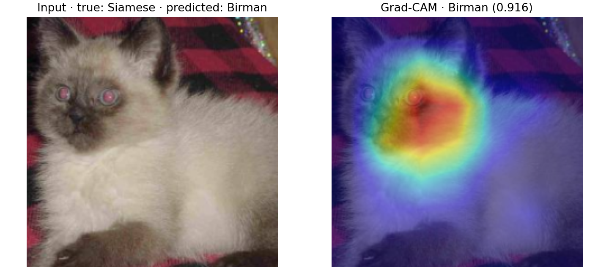
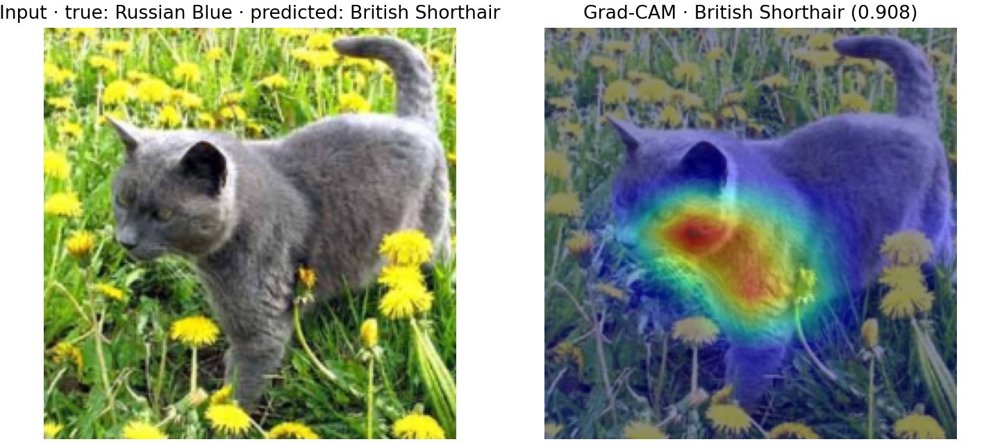
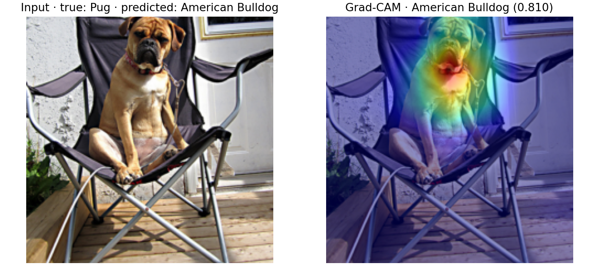

# Preliminary test-set results

**Status: complete.** All six frozen configurations have been evaluated on the
test split. The augmentation-off checkpoints were retained from the completed
validation ablation; no training was rerun for this test evaluation.

## Comparison

`src/evaluate.py` evaluated the frozen `splits/v2/test.csv` split (300 images)
with the retained checkpoints for training seeds 42, 43, and 44. Values are
mean ± sample standard deviation across those three checkpoints.

| Configuration | Accuracy (mean ± std) | Macro-F1 (mean ± std) | Artifacts |
| --- | ---: | ---: | --- |
| C0 · augmentation on | 0.9511 ± 0.0051 | 0.9512 ± 0.0051 | [Per-class F1](tables/C0_augment_on_test_per_class_f1.csv) · [confusion matrix](figures/C0_augment_on_test_confusion_matrix.png) · [latency](tables/C0_augment_on_test_latency.csv) |
| C1 · augmentation on | 0.9656 ± 0.0069 | 0.9655 ± 0.0070 | [Per-class F1](tables/C1_augment_on_test_per_class_f1.csv) · [confusion matrix](figures/C1_augment_on_test_confusion_matrix.png) · [latency](tables/C1_augment_on_test_latency.csv) |
| C2 · augmentation on | 0.9600 ± 0.0033 | 0.9601 ± 0.0033 | [Per-class F1](tables/C2_augment_on_test_per_class_f1.csv) · [confusion matrix](figures/C2_augment_on_test_confusion_matrix.png) · [latency](tables/C2_augment_on_test_latency.csv) |
| C3 · augmentation on | 0.9633 ± 0.0067 | 0.9633 ± 0.0067 | [Per-class F1](tables/C3_augment_on_test_per_class_f1.csv) · [confusion matrix](figures/C3_augment_on_test_confusion_matrix.png) · [latency](tables/C3_augment_on_test_latency.csv) |
| C0 · augmentation off | 0.9489 ± 0.0019 | 0.9485 ± 0.0020 | [Summary](tables/C0_augment_off_test_summary.csv) · [per-class F1](tables/C0_augment_off_test_per_class_f1.csv) · [predictions](tables/C0_augment_off_test_predictions.csv) · [confusion matrix](figures/C0_augment_off_test_confusion_matrix.png) · [latency](tables/C0_augment_off_test_latency.csv) |
| C3 · augmentation off | 0.9578 ± 0.0107 | 0.9579 ± 0.0107 | [Summary](tables/C3_augment_off_test_summary.csv) · [per-class F1](tables/C3_augment_off_test_per_class_f1.csv) · [predictions](tables/C3_augment_off_test_predictions.csv) · [confusion matrix](figures/C3_augment_off_test_confusion_matrix.png) · [latency](tables/C3_augment_off_test_latency.csv) |

Per-class F1 is the mean and sample standard deviation across the same three
checkpoints. Confusion matrices pool their predictions on the fixed test set.
The latency CSVs contain batch-1 and batch-32 measurements for each checkpoint;
these were measured on the local CPU and are hardware-specific. Full sample
predictions are available in the corresponding `*_predictions.csv` files.

## Augmentation-off checkpoint provenance

The six checkpoints below were recovered from `artifacts/ablation_noaug/runs/`.
Their embedded configs, copied `config.yaml` files, `metadata.json` files, and
run histories agree on condition, augmentation setting, learning rate, split
seed 42, and training seed. Each retained epoch is the first epoch attaining
that run's maximum validation macro-F1 (ties therefore do not use test data).

| Condition | Seed | LR | Retained epoch | Validation macro-F1 | Checkpoint SHA-256 |
| --- | ---: | ---: | ---: | ---: | --- |
| C0, augmentation off | 42 | `1e-3` | 9 | 0.9530799 | `204c59d0868ddb9370b8de3f6df147e703a0d9e75b619fb45039818481dabfda` |
| C0, augmentation off | 43 | `1e-3` | 14 | 0.9630994 | `f8346ddaf94add7e14305fc172c2eabea4f11e85db9f71bac1c8c6e0f68b01b4` |
| C0, augmentation off | 44 | `1e-3` | 17 | 0.9630994 | `70151c2c9504933030c899fd0a42b89c1a35c8b6051783f098e2aaddcce33d2e` |
| C3, augmentation off | 42 | `1e-5` | 7 | 0.9632574 | `ffd162fd45a19e379717c13ff54b4d16c03a57642a262acecca15abfa41879c6` |
| C3, augmentation off | 43 | `1e-5` | 7 | 0.9734389 | `5b0c73fe583599d173ca37e441f7e3deffd2003ef40c7f29a77df71412092dc5` |
| C3, augmentation off | 44 | `1e-5` | 8 | 0.9664709 | `4a4a847a8865540772da11eb0a7519db9d12cf1ac33508805c553c0c76f21034` |

C0 checkpoints embed `unfreeze: head`, `augment: false`, and LR `0.001`;
C3 checkpoints embed `unfreeze: all`, `augment: false`, and LR `0.00001`.
All use ResNet50 with `IMAGENET1K_V2` initialization. Per-run configs and
metadata are beside each checkpoint, for example
`artifacts/ablation_noaug/runs/c0_lr1e-3_seed42/{config.yaml,metadata.json}`.

## Augmentation-off evaluation commands

These commands produced the final test artifacts (line wrapping added only for
readability):

```powershell
python -m src.evaluate --condition C0 --checkpoints artifacts/ablation_noaug/runs/c0_lr1e-3_seed42/best.pt artifacts/ablation_noaug/runs/c0_lr1e-3_seed43/best.pt artifacts/ablation_noaug/runs/c0_lr1e-3_seed44/best.pt --config configs/c0_noaug.yaml --split test --device cpu
python -m src.evaluate --condition C3 --checkpoints artifacts/ablation_noaug/runs/c3_lr1e-5_seed42/best.pt artifacts/ablation_noaug/runs/c3_lr1e-5_seed43/best.pt artifacts/ablation_noaug/runs/c3_lr1e-5_seed44/best.pt --config configs/c3_noaug.yaml --split test --device cpu
```

The evaluation configs determine the condition and preprocessing. The selected
training LRs above are verified from each checkpoint's embedded training config
and adjacent run config; learning rate is not used during evaluation. Both
latency files contain 10 timed repeats after 3 warm-ups at batch sizes 1 and 32
for every checkpoint on the local CPU.

## Test error review

The detailed [failure analysis](failure_analysis.md) includes full source
images, regenerated Grad-CAM overlays, checkpoint/seed provenance, probable
causes, cross-seed observations, and limitations for the three cases below.

The examples below are C0 augmentation-on test errors. Probable causes describe
the visible image ambiguity and model attention; Grad-CAM is supporting
visualization, not proof of a causal explanation.

1. **`Siamese_257`: Siamese → Birman (seed 44, confidence 0.916).** The image
   is a tight, somewhat soft crop of a color-point cat. Grad-CAM concentrates
   around the face, where these two breeds share visible color-point features;
   the crop provides little body-shape context, and red-eye glare further
   obscures the eye detail.

   

2. **`Russian_Blue_264`: Russian Blue → British Shorthair (seed 44, confidence
   0.908).** This outdoor image shows a gray cat in a side-facing pose amid
   flowers. The heatmap focuses on the head and shoulder. Both classes have a
   solid blue-gray coat, while the pose, foliage, and lighting make fine facial
   and coat-texture differences harder to read.

   

3. **`pug_74`: Pug → American Bulldog (seed 42, confidence 0.810).** The dog is
   seated in a chair and photographed front-on. Attention is strongest around
   the face and muzzle. The short muzzle and tan coat are shared visual cues;
   the seated pose and chair obscure body proportions useful for distinguishing
   a small pug from a bulldog.

   

These are representative, high-confidence errors selected from the saved
per-image predictions. Test inspection is used only for this final descriptive
analysis.

## Protocol note

**No settings are changed based on test results.** Model selection and
hyperparameter choices were made from validation results before this test
evaluation. Test results are used only for reporting and error analysis; tuning
on them is forbidden.
